```{r setup}
#| include: false
source("R/01_simulate_data.R", local = new.env())
source("R/02_compute_numbers.R", local = new.env())
source("R/03_figures.R", local = new.env())

get_val <- function(file, key) {
  d <- read.csv(file.path("output", file))
  d[[2]][d[[1]] == key]
}
params   <- read.csv("output/sim_params.csv")
beta0    <- get_val("sim_params.csv", "beta0")
beta1    <- get_val("sim_params.csv", "beta1")
n_total  <- get_val("lm_numbers.csv", "n_total")
pred_lo  <- get_val("lm_numbers.csv", "lm_pred_min_x")
pred_hi  <- get_val("lm_numbers.csv", "lm_pred_max_x")
x_lo     <- get_val("lm_numbers.csv", "x_min_obs")
x_hi     <- get_val("lm_numbers.csv", "x_max_obs")
n_out    <- get_val("lm_numbers.csv", "n_fitted_outside_01")
x_mid    <- get_val("true_curve.csv", "x_at_pi_50")
x_mid2   <- get_val("true_curve.csv", "x_at_pi_50_beta1_doubled")
tt       <- read.csv("output/transform_table.csv")
odds_80  <- tt$odds[tt$pi == 0.8]

bn   <- read.csv("output/backup_numbers.csv")
bval <- function(key) bn$value[bn$quantity == key]
gn   <- read.csv("output/glm_numbers.csv")
gval <- function(key) gn$value[gn$quantity == key]
f1   <- function(x) formatC(x, format = "f", digits = 1)
f3   <- function(x) sub("^-", "\u2212", formatC(x, format = "f", digits = 3))

f2 <- function(x) sub("^-", "\u2212", formatC(x, format = "f", digits = 2))
pct <- function(x) paste0(formatC(100 * x, format = "f", digits = 0), " %")
materials_url <- "https://gidonfrischkorn.github.io/lehrprobe-logistische-regression/"

kn         <- read.csv("output/klicker_numbers.csv")
pi_check   <- kn$value[kn$quantity == "pi_check"]
odds_check <- kn$value[kn$quantity == "odds_check"]
fmt_pi <- function(x) sub("^0", "", formatC(x, format = "f", digits = 2))

rem_data <- read.csv("data/remission.csv")
x_anteil <- 35
im_fenster <- abs(rem_data$sitzungen - x_anteil) <= 2
n_fenster  <- sum(im_fenster)
k_fenster  <- sum(rem_data$remission[im_fenster])
pi_anteil  <- plogis(beta0 + beta1 * x_anteil)

lo_mid   <- round(beta0 + beta1 * x_mid, 8)
odds_mid <- round(exp(lo_mid), 8)
fnum <- function(x) sub("^-", "−", formatC(round(x, 2), format = "fg"))
fpi  <- function(x) sub("^0", "", formatC(round(x, 2), format = "fg"))

klicker_join_url <- rmarkdown::metadata[["klicker-join-url"]]
klicker_qr_file  <- "figures/klicker_qr.png"
klicker_qr_uzh   <- "figures/klickeruzh_qr.png"
has_url <- !is.null(klicker_join_url) && nzchar(klicker_join_url)
has_klicker <- has_url &&
  (file.exists(klicker_qr_uzh) || requireNamespace("qrcode", quietly = TRUE))
if (has_klicker && file.exists(klicker_qr_uzh)) {
  file.copy(klicker_qr_uzh, klicker_qr_file, overwrite = TRUE)
} else if (has_klicker) {
  png(klicker_qr_file, width = 600, height = 600, bg = "white")
  par(mar = c(0, 0, 0, 0)); plot(qrcode::qr_code(klicker_join_url, ecl = "M"))
  dev.off()
} else if (file.exists(klicker_qr_file)) {
  file.remove(klicker_qr_file)
}
join_box <- function(px, label = "KlickerUZH") {
  if (has_klicker) {
    cat(sprintf(paste0(
      '<div class="join-box"><span>%s</span></div>'),
      klicker_qr_file, px, px, klicker_join_url, label))
  } else {
    cat(sprintf('<div class="join-box join-missing">%s: Link fehlt (klicker-join-url in slides.qmd)</div>', label))
  }
}
```

## Wo stehen wir?

::: {.timeline}
::: {}
[Bisher]{.label}

- Statistik I: Binomialverteilung, Odds (Bayes-Beispiel)
- Letzte Sitzung: lineare Regression als Modell
    - Normalverteilung, deren Mittelwert von $x$ abhängt
:::
::: {.now .fragment fragment-index=2}
[Jetzt]{.label}
Was ändert sich, wenn die abhängige Variable nur 0 oder 1 sein kann?
:::
::: {.fragment fragment-index=1}
[Danach]{.label}
Koeffizienten als Odds Ratios interpretieren, Schätzung, `glm(family = binomial)` in R
:::
:::

::: {.notes}
In der letzten Sitzung hatten wir die lineare Regression als Modell: eine Normalverteilung, deren Mittelwert von x abhängt.

▸ Danach kommen die Koeffizienten als Odds Ratios, die Schätzung und glm() in R.

▸ Und dazwischen liegt heute: Was ändert sich, wenn die abhängige Variable nur 0 oder 1 sein kann? Dazu ein Beispiel.
:::

## Das Beispiel: Remission nach Psychotherapie {.remission}

`r n_total` Patient:innen (simulierte Daten), `r x_lo` bis `r x_hi` Therapiesitzungen. Remission heisst: Die Diagnosekriterien sind **nicht mehr erfüllt**.

:::: {.columns}
::: {.column width="50%"}
{.foto fig-alt="Schwarzweissfoto: eine Frau von hinten, den Kopf gesenkt."}

Kriterien weiter erfüllt: **keine Remission**, $Y = 0$
:::
::: {.column width="50%"}
{.foto fig-alt="Farbfoto: eine Frau von hinten, die mit erhobenen Armen in der Abendsonne durch ein Feld tanzt."}

Kriterien nicht mehr erfüllt: **Remission**, $Y = 1$
:::
::::

::: {.fragment .merke fragment-index=1}
Eine Diagnose ist erfüllt oder nicht. Deshalb ist **Remission binär**: 0 oder 1.
:::

::: {.notes}
Unser Beispiel: `r n_total` Patient:innen nach einer Psychotherapie, mit `r x_lo` bis `r x_hi` Sitzungen; die Daten sind simuliert. Die Frage ist: Wer ist remittiert? Remission heisst: Die Diagnosekriterien sind nicht mehr erfüllt.

Links sind die Kriterien weiter erfüllt, also keine Remission. Das ist eine 0. Rechts sind die Kriterien nicht mehr erfüllt, also remittiert. Das ist eine 1.

▸ Eine Diagnose ist erfüllt oder nicht, dazwischen gibt es nichts. Deshalb ist unsere **abhängige** Variable binär.
:::

## Ihre Intuition ist gefragt {.intuition}

:::: {.columns}
::: {.column width="62%"}
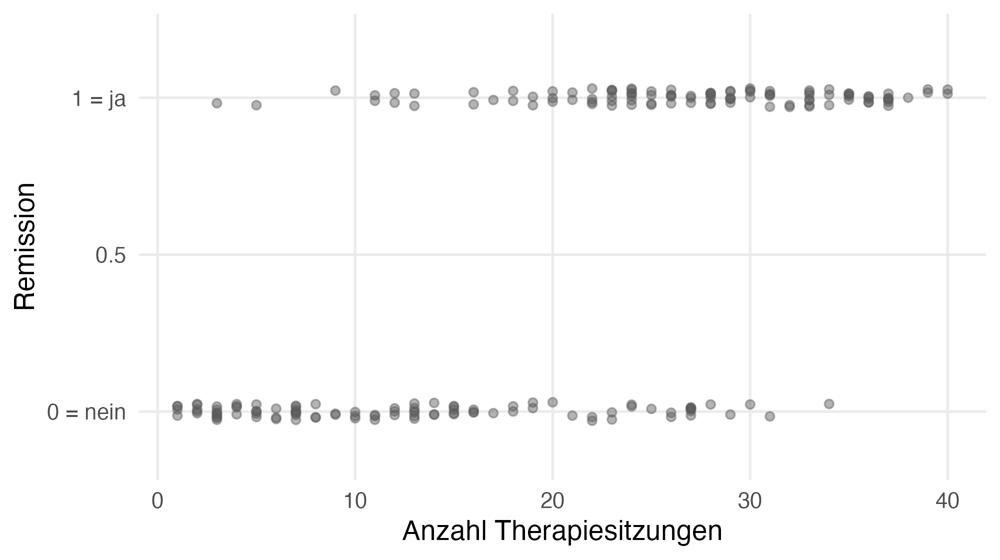{fig-alt="Streudiagramm: Remission (0 = nein, 1 = ja) gegen Anzahl Therapiesitzungen von 1 bis 40. Bei wenigen Sitzungen liegen fast alle Punkte bei 0, bei vielen Sitzungen fast alle bei 1."}
:::
::: {.column width="38%"}
::: {.klicker}
**KlickerUZH:** Was passiert, wenn wir eine lineare Regression mit einer binären abhängigen Variable rechnen?

A. Kein Problem: Die Gerade sagt für alle Sitzungszahlen Werte zwischen 0 und 1 vorher.

B. Für manche Sitzungszahlen sagt die Gerade Werte unter 0 oder über 1 vorher.

C. Eine solche Analyse kann man nicht rechnen, R bricht mit einer Fehlermeldung ab.
:::

```{r join-slide3}
#| results: asis
join_box(130)
```
:::
::::

::: {.notes}
So sehen die Daten aus: bei wenigen Sitzungen fast nur Nullen, bei vielen fast nur Einsen.

[Klicker Block 1 öffnen]

Rechts steht die Frage. Schätzen Sie, ohne zu rechnen, 30 Sekunden. Wer noch nicht drin ist: QR-Code rechts.

[Countdown 35 s, der Block schliesst sich selbst. Nach 1:55 noch offen: Block schliessen. Klicker tot: Handzeichen A, B, C]

[Ergebnis auf dem Handy ablesen, nicht projizieren]

- *Meist B:* Die meisten sagen B: Die Gerade verlässt den Bereich von 0 bis 1. Schauen wir, wie weit.
- *Gespalten:* Sie sind sich nicht einig. Gut, dann schauen wir nach.
- *Meist A oder C:* Die meisten sagen A (oder: C). Schauen wir, ob R das auch so sieht.
:::

## Was passiert mit der Geraden? {.nostretch}

:::: {.columns}
::: {.column width="68%"}
::: {.r-stack .layers}
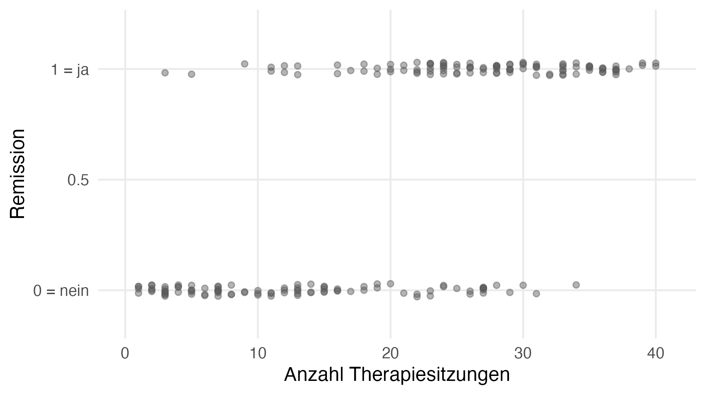{fig-alt="Streudiagramm: Remission (0 = nein, 1 = ja) gegen Anzahl Therapiesitzungen von 1 bis 40, dieselben Daten wie auf der Klicker-Folie."}

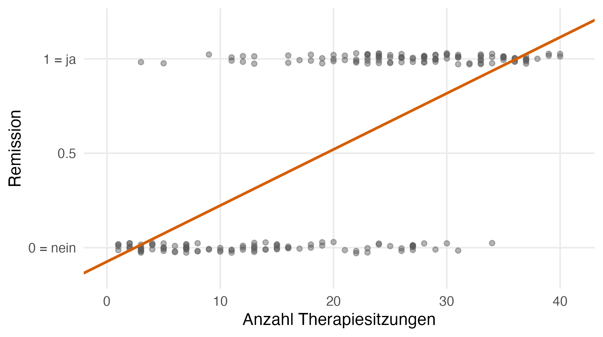{.fragment fragment-index=1 fig-alt="Dieselben Daten mit der Regressionsgeraden der linearen Regression. Die Gerade steigt von links unten nach rechts oben."}

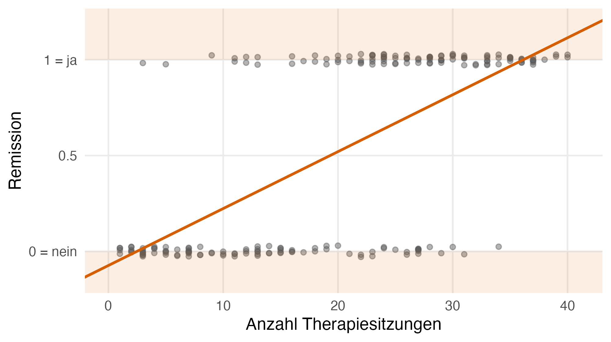{.fragment fragment-index=2 fig-alt="Dieselben Daten mit der Regressionsgeraden. Die Bereiche unter 0 und über 1 sind orange schattiert; die Gerade liegt links unter 0 und rechts über 1."}

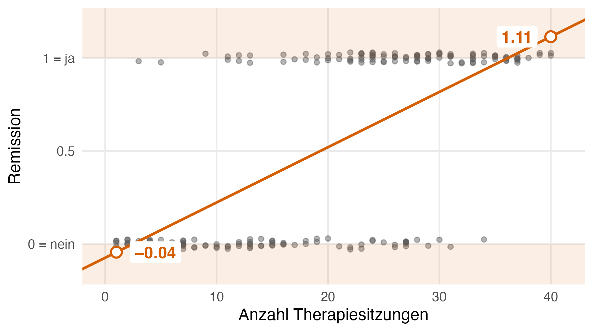{.fragment fragment-index=3 fig-alt="Wie zuvor, zusätzlich sind die Vorhersagen der Geraden bei 1 und bei 40 Sitzungen als Kreise markiert und beschriftet: `r f2(pred_lo)` und `r f2(pred_hi)`."}
:::
:::
::: {.column .lm-code width="32%"}
::: {.fragment fragment-index=1}
Die Gerade in R:

```{.r code-line-numbers="false"}
lm(remission ~ sitzungen,
   data = remission_data)
```

Keine Warnung, keine Fehlermeldung.
:::

::: {.fragment .merke fragment-index=4}
R rechnet jedes Modell, das Sie angeben. **Welches Modell passt, entscheiden Sie.**
:::
:::
::::

::: {.fragment .vorhersage fragment-index=3}
- Bei `r x_hi` Sitzungen: **`r f2(pred_hi)`**, also eine «Wahrscheinlichkeit» von `r pct(pred_hi)`?
- Bei `r x_lo` Sitzung: **`r f2(pred_lo)`**
- `r n_out` von `r n_total` vorhergesagten Werten liegen ausserhalb von 0 bis 1.
:::

::: {.notes}
Hier noch einmal die Daten, noch ohne Gerade.

▸ Rechts der Befehl aus der letzten Sitzung. R rechnet das klaglos: keine Warnung, keine Fehlermeldung. Antwort C fällt also weg. Links sehen Sie die Gerade dazu.

▸ Orange sind die Bereiche unter 0 und über 1. Wahrscheinlichkeiten gibt es nur zwischen 0 und 1.

▸ Bei `r x_hi` Sitzungen sagt die Gerade `r f2(pred_hi)` vorher, eine Wahrscheinlichkeit von `r pct(pred_hi)`. Bei `r x_lo` Sitzung sagt sie `r f2(pred_lo)`. `r n_out` von `r n_total` vorhergesagten Werten liegen ausserhalb von 0 bis 1. Das ist Antwort B.

▸ R prüft nicht, ob das Modell zu Ihrer abhängigen Variable passt. Welches Modell passt, entscheiden Sie. Das Problem liegt also nicht in der Geraden, sondern im Modell dahinter. Dafür gehen wir einen Schritt zurück.
:::

## Jede Regression beruht auf einer Verteilungsannahme {.nostretch .verteilung}

::::: {.columns}
:::: {.column width="50%"}
[Lineare Regression]{.lm}

$$Y_i \sim \mathcal{N}(\mu_i,\ \sigma^2), \quad \mu_i = \beta_0 + \beta_1 x_i$$

[Normalverteilung ($\mathcal{N}$) um den Mittelwert $\mu_i$; $\mu_i$ liegt auf der Geraden.]{.lesehilfe}

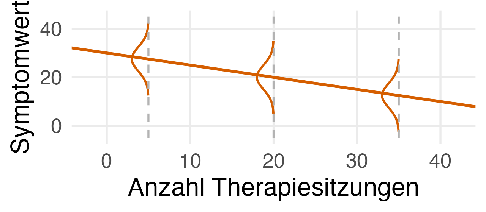{fig-alt="Regressionsgerade für einen Symptomwert mit Normalverteilungen um den Mittelwert bei 5, 20 und 35 Sitzungen." width="88%"}
::::
:::: {.column width="50%"}
::: {.fragment fragment-index=1}
[Binäre abhängige Variable: Remission]{.logit}

$$Y_i \sim \mathcal{B}(1,\ \pi_i), \quad \pi_i = \ ?$$

[Binomialverteilung ($\mathcal{B}$), ein Versuch: $Y_i = 1$ mit Wahrscheinlichkeit $\pi_i$, sonst 0.]{.lesehilfe}
:::

::: {.r-stack}
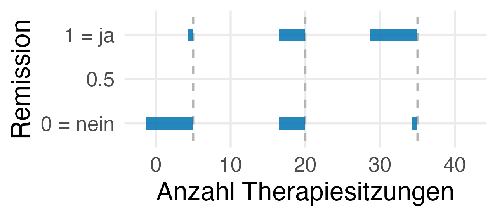{.fragment fragment-index=2 fig-alt="Balken für die Wahrscheinlichkeit von 0 und 1 bei 5, 20 und 35 Sitzungen; mit mehr Sitzungen wächst der Balken bei 1." width="88%"}

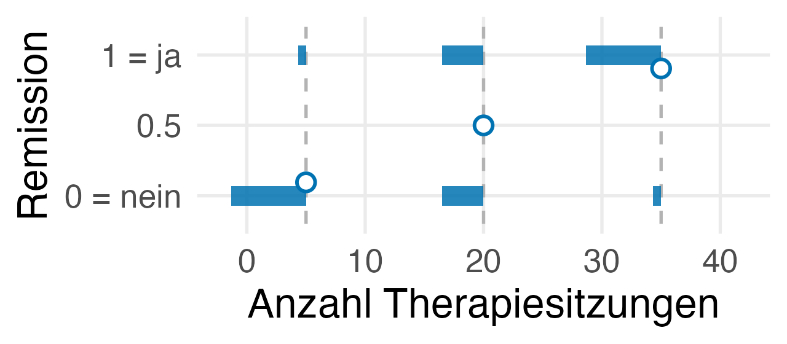{.fragment fragment-index=3 fig-alt="Dieselben Balken; zusätzlich markiert bei 5, 20 und 35 Sitzungen je ein Kreis pi, die Wahrscheinlichkeit für 1. Mit mehr Sitzungen liegt der Kreis höher." width="88%"}
:::
::::
:::::

::: {.fragment .merke fragment-index=4}
Gleiche Struktur: eine **Verteilung** und ein **Parameter, der von $x$ abhängt**. Vorhergesagt wird dieser Parameter, nicht der einzelne Wert $Y_i$.
:::

::: {.notes}
Jede Regression beruht auf einer Verteilungsannahme. Links die lineare Regression: Jede Person hat ihre eigene Normalverteilung, und deren Mittelwert μᵢ liegt auf der Geraden.

▸ Eine Normalverteilung verteilt Wahrscheinlichkeit auf alle Werte, auch auf 0.3 oder 1.4. Y kennt aber nur 0 und 1. Die Verteilung einer 0/1-Variable kennen Sie aus Statistik I: die Binomialverteilung. Wir ziehen pro Person genau einmal, also n gleich 1. Nichts anderes passt zu dieser abhängigen Variable.

▸ Die Balken zeigen die Wahrscheinlichkeit für 0 und für 1. Mit wenigen Sitzungen meist 0, mit vielen Sitzungen meist 1.

▸ Der Kreis ist πᵢ, die Wahrscheinlichkeit für eine 1. Ob eine einzelne Person remittiert, sagt kein Modell sicher vorher. Von den Sitzungen hängt ab, wie häufig Remission vorkommt: πᵢ ist der Anteil Remissionen bei gleich vielen Sitzungen. In unseren Daten, bei `r x_anteil - 2` bis `r x_anteil + 2` Sitzungen: `r k_fenster` von `r n_fenster`; das Modell sagt `r sub("^\\.", "Punkt ", fmt_pi(pi_anteil))`. Was liegt nahe für πᵢ?

[kurz warten; erwartet: «die Gerade, wie links»]

▸ Gleiche Struktur: eine Verteilung und ein Parameter, der von x abhängt. Links sagt die Regression μᵢ vorher, nicht den Wert jeder Person; rechts genauso πᵢ, nicht die 0 oder 1. Die Gerade auf Folie 5 hat πᵢ direkt auf die Gerade gesetzt, und das ging schief. Warum? Nächste Folie.
:::

## Das Problem: der Wertebereich

$\pi_i$ liegt zwischen 0 und 1, aber $\beta_0 + \beta_1 x_i$ kann jeden Wert annehmen.

```{=html}
<table class="leiter">
  <tr class="fragment" data-fragment-index="1"><td><b>Wahrscheinlichkeit</b></td><td>\(\pi\)</td><td class="range">0 bis 1</td><td>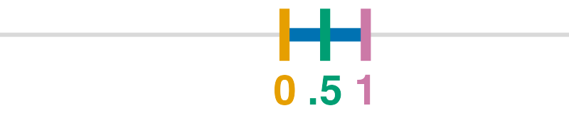</td></tr>
  <tr class="fragment" data-fragment-index="2"><td><b>Odds</b></td><td>\(\dfrac{\pi}{1-\pi}\)</td><td class="range">0 bis ∞</td><td></td></tr>
  <tr class="fragment" data-fragment-index="3"><td><b>Log-Odds</b></td><td>\(\ln\!\left(\dfrac{\pi}{1-\pi}\right)\)</td><td class="range">−∞ bis ∞</td><td>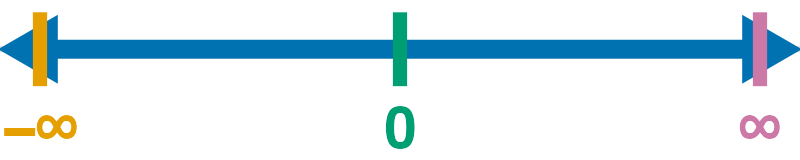</td></tr>
</table>
```

::: {.fragment fragment-index=3}
[$\pi$: Wahrscheinlichkeit einer Remission · Odds (Chance): Wahrscheinlichkeit dafür geteilt durch dagegen · Farbe: dasselbe $\pi$]{.lesehilfe}
:::

::: {.fragment .denkpause fragment-index=4}
**Denkpause:** Wenn $\pi = .8$, wie gross sind die Odds?
:::

::: {.fragment fragment-index=5}
$.8 / .2 = `r odds_80`$: Auf `r odds_80` Remissionen kommt eine Nicht-Remission. Kennen Sie aus dem Bayes-Beispiel in Statistik I (Prior-Odds).
:::

::: {.notes}
Das Problem ist der Wertebereich: π liegt zwischen 0 und 1, die Gerade kann jeden Wert annehmen. Wir brauchen also eine Umrechnung.

▸ Erste Zeile: die Wahrscheinlichkeit, von 0 bis 1. Die Farben: Orange ist π = 0, grün ist π = Punkt 5, lila ist π = 1.

▸ Zweite Zeile: die Odds, die Wahrscheinlichkeit **geteilt durch** die Gegenwahrscheinlichkeit, also π durch 1 minus π. Sie laufen von 0 bis unendlich: Orange bleibt bei 0, grün wird 1, lila geht nach unendlich. Nach oben ist die Grenze weg, nach unten nicht.

▸ Dritte Zeile: Wir nehmen den Logarithmus der Odds, die Log-Odds. Was ist hier der kleinste, was der grösste Wert?

[kurz warten]

Minus unendlich und plus unendlich: Orange wandert nach minus unendlich, grün liegt bei 0, lila bei plus unendlich. Das ist der Umweg: Log-Odds decken den ganzen Zahlenstrahl ab, genau wie β₀ plus β₁ x. Nur die darf man gleichsetzen. Andere Umrechnungen mit dieser Eigenschaft gäbe es; wir nehmen die Odds, weil Sie sie kennen und weil β₁ nächste Sitzung ein Odds Ratio wird.

▸ Eine Denkpause: Wenn π Punkt 80 ist, wie gross sind die Odds?

[15 s warten]

▸ Punkt 80 durch Punkt 20 ist `r odds_80`. Auf `r odds_80` Remissionen kommt eine Nicht-Remission. Das kennen Sie aus dem Bayes-Beispiel in Statistik I. Auf der Log-Odds-Skala liegen Punkt 20 und Punkt 80 symmetrisch um 0.
:::

## Das logistische Regressionsmodell

:::: {.columns}
::: {.column .modell-links width="48%"}
$$Y_i \sim \mathcal{B}(1,\ \pi_i)$$

::: {.r-stack}
::: {.fragment .fade-out fragment-index=1}
$$\pi_i = \ ?$$
:::
::: {.fragment fragment-index=1}
$$
\underbrace{\ln\!\left(\frac{\pi_i}{1-\pi_i}\right)}_{\text{Logit} \,=\, \text{Log-Odds von } \pi_i}
= \underbrace{\beta_0 + \beta_1 x_i}_{\text{die lineare Gleichung}}
$$
:::
:::

::: {.fragment fragment-index=2}
Zurück zur Wahrscheinlichkeit:

::: {.fragment .highlight-current-blue fragment-index=2}
$$\text{Odds}_i = e^{\text{Log-Odds}_i} = e^{\beta_0 + \beta_1 x_i}$$
:::
:::

::: {.fragment fragment-index=3}
::: {.fragment .highlight-current-blue fragment-index=3}
$$
\pi_i = \frac{\text{Odds}_i}{1 + \text{Odds}_i}
= \frac{e^{\beta_0 + \beta_1 x_i}}{1 + e^{\beta_0 + \beta_1 x_i}}
$$
:::
:::
:::
::: {.column width="52%"}
::: {.fragment fragment-index=4}
[Logistische (sigmoide) Funktion]{.fig-titel}

::: {.r-stack .s-kurve}
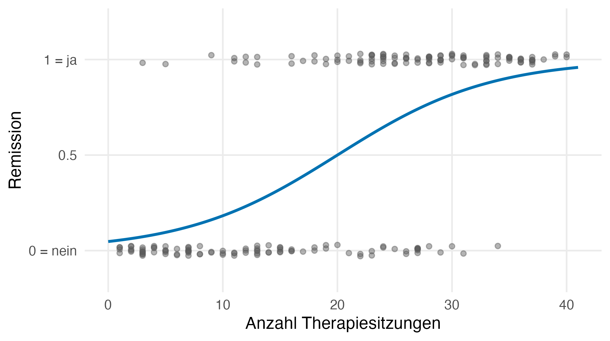{fig-alt="Dieselben Daten mit einer S-förmigen Kurve, die von nahe 0 bei wenigen Sitzungen auf nahe 1 bei vielen Sitzungen ansteigt und den Bereich 0 bis 1 nie verlässt."}

::: {.fragment fragment-index=7}
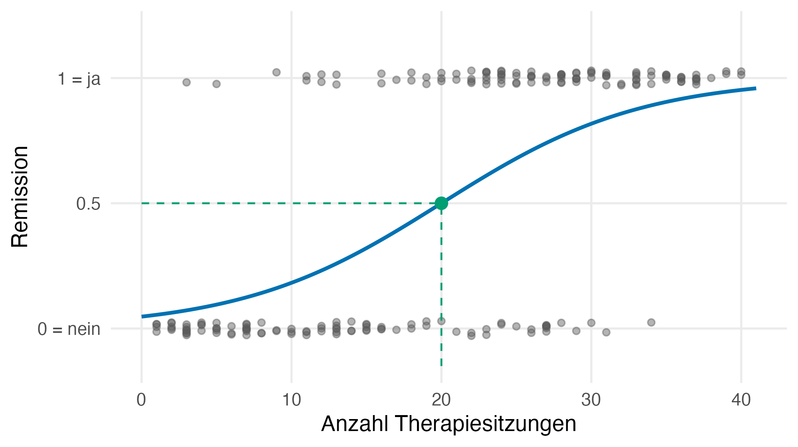{fig-alt="Dieselbe S-Kurve, zusätzlich mit gestrichelten Linien bei 20 Sitzungen und π = .5 und einem Punkt im Schnittpunkt."}
:::
:::

::: {.rechenbeispiel}
**Beispiel:** $\beta_0 = `r beta0`$, $\beta_1 = `r beta1`$, $x = `r x_mid`$ Sitzungen

::: {.schritt .fragment fragment-index=5}
[1]{.nr} [Log-Odds]{.was} $`r beta0` + `r beta1` \cdot `r x_mid` = `r lo_mid`$
:::

::: {.schritt .fragment fragment-index=6}
[2]{.nr} [Odds]{.was} $e^{`r lo_mid`} = `r odds_mid`$
:::

::: {.schritt .fragment fragment-index=7}
[3]{.nr} [Wahrscheinlichkeit]{.was} $\pi = `r odds_mid` / (1 + `r odds_mid`) = `r fpi(plogis(lo_mid))`$
:::
:::
:::
:::
::::

::: {.notes}
Zurück zum Modell. Oben steht wie vorhin: Remission folgt der Binomialverteilung mit dem Parameter πᵢ. Offen ist: Was setzen wir für πᵢ ein?

▸ Nicht πᵢ selbst, sondern seine Log-Odds setzen wir gleich der linearen Gleichung. Die Log-Odds heissen auch Logit, das Wort steht unter der Klammer.

▸ Zurück zur Wahrscheinlichkeit geht es in zwei Schritten. Erstens: e hoch macht den Logarithmus rückgängig, aus Log-Odds werden Odds.

▸ Zweitens: Odds durch 1 plus Odds ergibt die Wahrscheinlichkeit, wie im Bayes-Beispiel.

▸ Das ist die Kurve dazu. Sie bleibt zwischen 0 und 1, egal wie viele Sitzungen. Sie heisst logistische Funktion, daher der Name der Methode. Rechnen wir eine Stelle durch: `r x_mid` Sitzungen.

▸ `r fnum(beta0)` plus `r beta1` mal `r x_mid` ist `r lo_mid`. Das sind die Log-Odds.

▸ e hoch `r lo_mid` ist `r odds_mid`. Das sind die Odds.

▸ `r odds_mid` durch 1 plus `r odds_mid` ist `r sub("^\\.", "Punkt ", fpi(plogis(lo_mid)))`. Bei `r x_mid` Sitzungen ist π also `r sub("^\\.", "Punkt ", fpi(plogis(lo_mid)))`, hier der Punkt auf der Kurve.

[Uhr, Soll 7:20. Nach 8:40 noch hier: Folie 9 nur Frage und Animieren, dann G 11 Enter. Nach 9:00 noch hier: sofort G 11 Enter]
:::

## Gedankenexperiment: schneller wirkende Therapie {.nostretch}

```{r slider-data}
#| results: asis
d <- read.csv("data/remission.csv")
cat("<script>window.remissionData = ",
    jsonlite::toJSON(d[, c("sitzungen", "remission")]),
    "; window.logitStart = ",
    jsonlite::toJSON(list(b0 = beta0, b1 = beta1), auto_unbox = TRUE),
    ";</script>", sep = "")
```

```{=html}
<div class="logit-widget">
  <div class="slider-controls">
    <label>Achsenabschnitt β₀ = <b id="b0-val"></b>
      <input type="range" id="b0" min="-8" max="4" step="0.1"></label>
    <label>Steigung β₁ = <b id="b1-val"></b>
      <input type="range" id="b1" min="-0.3" max="0.6" step="0.01"></label>
    <label><input type="checkbox" id="show-ref" checked> Ausgangskurve</label>
    <div class="slider-buttons">
      <button id="animate" type="button">Animieren</button>
      <button id="reset" type="button">Zurücksetzen</button>
    </div>
  </div>
  <svg id="logit-svg" viewBox="0 0 900 400" role="img"
       aria-label="Interaktive S-Kurve der logistischen Regression"></svg>
</div>
<script>
(function () {
  const data = window.remissionData, start = window.logitStart;
  const svg = document.getElementById("logit-svg");
  const W = 900, H = 400, m = {l: 90, r: 20, t: 15, b: 55};
  const xMin = 0, xMax = 41, yMin = -0.15, yMax = 1.2;
  const sx = x => m.l + (x - xMin) / (xMax - xMin) * (W - m.l - m.r);
  const sy = y => H - m.b - (y - yMin) / (yMax - yMin) * (H - m.t - m.b);
  const ns = "http://www.w3.org/2000/svg";
  const el = (tag, attrs, parent) => {
    const e = document.createElementNS(ns, tag);
    for (const k in attrs) e.setAttribute(k, attrs[k]);
    (parent || svg).appendChild(e);
    return e;
  };
  [0, 0.5, 1].forEach(v => {
    el("line", {x1: sx(xMin), x2: sx(xMax), y1: sy(v), y2: sy(v),
                stroke: "#e3e3e3", "stroke-width": 1.5});
    const t = el("text", {x: m.l - 10, y: sy(v) + 6, "text-anchor": "end",
                          "font-size": 20, fill: "#555"});
    t.textContent = v === 0 ? "0 = nein" : v === 1 ? "1 = ja" : "0.5";
  });
  [0, 10, 20, 30, 40].forEach(v => {
    el("line", {x1: sx(v), x2: sx(v), y1: sy(yMin), y2: sy(yMax),
                stroke: "#f0f0f0", "stroke-width": 1.5});
    const t = el("text", {x: sx(v), y: H - m.b + 26, "text-anchor": "middle",
                          "font-size": 20, fill: "#555"});
    t.textContent = v;
  });
  const xl = el("text", {x: (m.l + W - m.r) / 2, y: H - 6,
                         "text-anchor": "middle", "font-size": 22});
  xl.textContent = "Anzahl Therapiesitzungen";
  data.forEach((d, i) => {
    const jit = ((i * 37) % 13 - 6) / 6 * 0.03;
    el("circle", {cx: sx(d.sitzungen), cy: sy(d.remission + jit), r: 4.5,
                  fill: "#595959", "fill-opacity": 0.45});
  });
  const refPath = el("path", {fill: "none", stroke: "#0072B2",
    "stroke-width": 3, "stroke-dasharray": "8 6", "stroke-opacity": 0.5});
  const curPath = el("path", {fill: "none", stroke: "#009E73",
                              "stroke-width": 4.5});
  const midLine = el("line", {stroke: "#009E73", "stroke-width": 2,
                              "stroke-dasharray": "4 4"});
  const midText = el("text", {"font-size": 20, fill: "#009E73",
                              stroke: "#fff", "stroke-width": 5,
                              "paint-order": "stroke", "text-anchor": "start"});
  const pathFor = (b0, b1) => {
    let p = "";
    for (let k = 0; k <= 200; k++) {
      const x = xMin + k / 200 * (xMax - xMin);
      const y = 1 / (1 + Math.exp(-(b0 + b1 * x)));
      p += (k ? "L" : "M") + sx(x).toFixed(1) + "," + sy(y).toFixed(1);
    }
    return p;
  };
  refPath.setAttribute("d", pathFor(start.b0, start.b1));
  const b0In = document.getElementById("b0"), b1In = document.getElementById("b1");
  const showRef = document.getElementById("show-ref");
  const fmt = (v, d) => Number(v).toFixed(d).replace("-", "−");
  function update() {
    const b0 = +b0In.value, b1 = +b1In.value;
    document.getElementById("b0-val").textContent = fmt(b0, 1);
    document.getElementById("b1-val").textContent = fmt(b1, 2);
    curPath.setAttribute("d", pathFor(b0, b1));
    refPath.style.display = showRef.checked ? "" : "none";
    const xm = b1 !== 0 ? -b0 / b1 : NaN;
    if (isFinite(xm) && xm >= xMin && xm <= xMax) {
      midLine.setAttribute("x1", sx(xm)); midLine.setAttribute("x2", sx(xm));
      midLine.setAttribute("y1", sy(0.5)); midLine.setAttribute("y2", sy(yMin));
      let right = b1 > 0;
      if (right && sx(xm) > W - m.r - 270) right = false;
      if (!right && sx(xm) < m.l + 270) right = true;
      midText.setAttribute("text-anchor", right ? "start" : "end");
      midText.setAttribute("x", sx(xm) + (right ? 10 : -10));
      midText.setAttribute("y", sy(0.5) + 26);
      midText.textContent = "π = .5 bei " + fmt(xm, 1) + " Sitzungen";
      midLine.style.display = midText.style.display = "";
    } else {
      midLine.style.display = midText.style.display = "none";
    }
  }
  let tween = null;
  function stopTween() { if (tween !== null) cancelAnimationFrame(tween); tween = null; }
  function animate() {
    stopTween();
    const from = start.b1, to = 2 * start.b1, dur = 1500;
    b0In.value = start.b0; b1In.value = from; update();
    const t0 = performance.now();
    const step = now => {
      const u = Math.min(1, (now - t0) / dur);
      const e = u < 0.5 ? 2 * u * u : 1 - Math.pow(-2 * u + 2, 2) / 2;
      b1In.value = from + (to - from) * e;
      update();
      tween = u < 1 ? requestAnimationFrame(step) : null;
    };
    tween = requestAnimationFrame(step);
  }
  function reset() { stopTween(); b0In.value = start.b0; b1In.value = start.b1; update(); }
  [b0In, b1In, showRef].forEach(e => e.addEventListener("input", update));
  [b0In, b1In].forEach(e => e.addEventListener("input", stopTween));
  document.getElementById("reset").addEventListener("click", reset);
  document.getElementById("animate").addEventListener("click", ev => {
    animate(); ev.currentTarget.blur();
  });
  [b0In, b1In].forEach(e => e.addEventListener("keydown", ev => ev.stopPropagation()));
  reset();
})();
</script>
```

::: {.notes}
[Kürzungspunkt A: Ankunft nach 7:40, dann ohne Nebenan-Frage direkt Animieren]

Eine Therapie wirkt schneller: β₁ verdoppelt sich, von `r beta1` auf `r f2(2 * beta1)`. Bei der alten Kurve liegt π = Punkt 5 bei `r x_mid` Sitzungen. Bei wie vielen Sitzungen liegt dieser Punkt, wenn β₁ doppelt so gross ist? Kurz mit Ihrem Nebenan.

[10 s warten, dann Animieren]

Steiler, und π = Punkt 5 wandert von `r x_mid` auf `r x_mid2` Sitzungen, an der grünen Linie. Das ist die halbe Strecke, weil π = Punkt 5 bei minus β₀ durch β₁ liegt. Die Steigung beschreibt den Zusammenhang in diesen Daten; ob die Sitzungen die Remission bewirken, sagt sie nicht.

[Nur falls gefragt: bei `r x_mid` Sitzungen ist π jetzt `r sub("^\\.", "Punkt ", fpi(plogis(beta0 + 2 * beta1 * x_mid)))`. Sonst keine weiteren Zahlen]

[Uhr: fertig bis 8:15, Selbsttest voll. 8:15 bis 8:40, Selbsttest kurz. Nach 8:40: G 11 Enter]
:::

## Selbst-Check: Was haben Sie behalten? {.selbsttest}

:::: {.columns}
::: {.column width="72%"}
::: {.klicker}
**KlickerUZH (K-Prim):** Welche der folgenden Aussagen über die logistische Regression treffen zu? Wählen Sie für jede Aussage aus, ob sie richtig oder falsch ist.

A. Im Modell haben zwei Personen mit gleich vielen Sitzungen dieselbe Wahrscheinlichkeit $\pi_i$, auch wenn eine remittiert und die andere nicht.

B. In der logistischen Regression ist $\pi_i$ eine lineare Funktion der Anzahl Sitzungen $x_i$.

C. Wenn die Odds $`r odds_check`$ betragen, ist $\pi = `r fmt_pi(pi_check)`$.

D. Log-Odds liegen wie Wahrscheinlichkeiten zwischen 0 und 1.
:::
:::
::: {.column width="28%"}
```{r join-slide10}
#| results: asis
join_box(130, "40 Sekunden")
```
:::
::::

::: {.notes}
[Klicker Block 2 öffnen]

Zum Schluss prüfen Sie selbst: vier Aussagen, je richtig oder falsch. 40 Sekunden.

[warten, nicht kommentieren. Der Block schliesst nach 40 s; stehen die Balken früher: Block schliessen]

[Fenster: Ctrl+Tab zur Auswertung, Lösung einblenden. Ein Balken auffällig falsch: diesen Satz zuerst]

A ist richtig. Ein Parameter pro Person, aber er hängt nur von x ab, wie μᵢ in der linearen Regression. Verschieden ist nur noch der Ausgang Y.

B ist falsch. Linear sind die Log-Odds. π folgt der S-Kurve und bleibt zwischen 0 und 1.

C ist richtig. `r odds_check` durch 1 plus `r odds_check` ist `r sub("^\\.", "Punkt ", fmt_pi(pi_check))`: `r odds_check` Remissionen auf eine Nicht-Remission.

D ist falsch. Log-Odds laufen von minus bis plus unendlich; unter π = Punkt 5 sind sie negativ. Genau deshalb darf hier eine Gerade stehen.

[Kurz, bei 8:15 bis 8:40: Block nach 25 s schliessen, dann zwei Sätze. «A richtig, B falsch: πᵢ hängt nur von x ab, aber nicht linear; linear sind die Log-Odds.» «C richtig, D falsch: `r odds_check` durch 1 plus `r odds_check` ist `r sub("^\\.", "Punkt ", fmt_pi(pi_check))`, und Log-Odds laufen von minus bis plus unendlich.»]

[Fenster: Ctrl+Tab zurück zu den Folien]
:::

## Mitnehmen

::: {.merke}
1. Jedes Regressionsmodell: eine **Verteilung** plus ein **Parameter, der von $x$ abhängt**. Normalverteilung mit $\mu_i$ für stetige, $\mathcal{B}(1, \pi_i)$ für binäre abhängige Variablen.
2. Weil die Wahrscheinlichkeit $\pi_i$ zwischen 0 und 1 liegt, modellieren wir ihre **Log-Odds** als lineare Funktion von $x$ (Anzahl Sitzungen). So sagt das Modell nie eine unmögliche Remissionswahrscheinlichkeit vorher.
:::

::: {.fragment fragment-index=1}
**Als Nächstes:** Was bedeutet die Steigung $\beta_1$? Odds Ratios · Schätzung · in R:

```r
glm(remission ~ sitzungen, family = binomial, data = remission_data)
```
:::

:::: {.columns .material}
::: {.column width="70%"}
**Material, Daten und R-Code:**<br>
[`r materials_url`](`r materials_url`)
:::
::: {.column width="30%"}
```{r qr}
#| fig-width: 2
#| fig-height: 2
#| fig-alt: "QR-Code zur Materialseite"
if (requireNamespace("qrcode", quietly = TRUE)) {
  plot(qrcode::qr_code(materials_url))
}
```
:::
::::

::: {.notes}
Das sind die zwei Sätze zum Mitnehmen.

[Ohne Selbsttest, nach G 11 Enter, stattdessen: «Wir behalten die Struktur des Modells, tauschen die Verteilung aus und transformieren den Parameter so, dass der lineare Teil passt.»]

▸ Als Nächstes: was β₁ = `r beta1` heisst, also Odds Ratios, und glm() in R. Material und Daten finden Sie unter dem Link. Vielen Dank.
:::

# Backup {#bk-index .section-divider background-color="#12355b" visibility="uncounted"}

:::: {.backup-index}
::: {}
<p class="verb">Modell</p>

- [Drei Gründe gegen `lm()` mit 0/1](#bk-lm)
- [Logit oder Probit?](#bk-probit)
- [Perfekte Trennung](#bk-trennung)
:::

::: {}
<p class="verb">Interpretation</p>

- [Gedankenexperiment: β₁ verdoppelt](#bk-doppelt)
- [β₁ = `r beta1`: Odds × `r f2(bval("or_1"))` pro Sitzung](#bk-or)
- [Gleicher Schritt in π, ungleich viele Sitzungen](#bk-schritt)
:::

::: {}
<p class="verb">Schätzung und Güte</p>

- [Wie werden β₀ und β₁ geschätzt?](#bk-ml)
- [Wo ist R²?](#bk-r2)
:::
::::

## Drei Gründe gegen `lm()` mit 0/1 {#bk-lm .backup visibility="uncounted"}
<p class="track"><span class="kicker">Backup</span><span class="g on">Modell</span><span class="g">Interpretation</span><span class="g">Schätzung</span><a class="back" href="#/bk-index">↩ Index</a></p>

:::: {.columns .vcenter}
::: {.column width="48%"}
::: {.gruende}
<div><span class="nr">1</span><div><b>Wertebereich</b><span>Vorhersagen ausserhalb 0 bis 1: `r f2(pred_hi)` bei `r x_hi` Sitzungen, `r n_out` von `r n_total` Werten</span></div></div>
<div><span class="nr">2</span><div><b>Varianz hängt von $x$ ab</b><span>$\pi_i(1-\pi_i)$: `r fmt_pi(bval("var_50"))` bei $\pi = .5$, `r fmt_pi(bval("var_95"))` bei $.95$. Gleiche Streuung überall? Nein.</span></div></div>
<div><span class="nr">3</span><div><b>Residuen</b><span>pro $x$ nur zwei mögliche Werte, nicht normalverteilt</span></div></div>
:::
:::
::: {.column width="52%"}
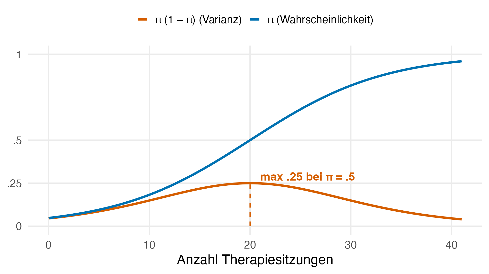{fig-alt="Zwei Kurven über die Anzahl Sitzungen: die S-Kurve der Wahrscheinlichkeit in Blau und die Varianz pi mal 1 minus pi in Orange, die bei 20 Sitzungen ihr Maximum .25 erreicht und zu beiden Seiten abfällt." width="100%"}
:::
::::

::: {.src}
Eid, Gollwitzer & Schmitt (2017), S. 802–803: Vertiefung «Einfache logistische Regression und einfache lineare Regression», F 22.2, Abb. 22.4
:::

::: {.notes}
Drei Gründe, und alle drei stehen so bei Eid. Erstens der Wertebereich, den
Sie auf Folie 5 gesehen haben. Zweitens die Varianz: Bei einer 0/1-Variable ist sie
π mal 1 minus π. Die orange Kurve zeigt sie: am grössten bei π = .5, fast null an den
Rändern. Die Gerade nimmt überall gleiche Streuung an, das kann hier nicht stimmen.
Drittens die Residuen: Pro Sitzungszahl gibt es nur zwei mögliche Werte, das ist keine
Normalverteilung.
:::

## Logit oder Probit? Praktisch dieselbe Kurve {#bk-probit .backup visibility="uncounted"}
<p class="track"><span class="kicker">Backup</span><span class="g on">Modell</span><span class="g">Interpretation</span><span class="g">Schätzung</span><a class="back" href="#/bk-index">↩ Index</a></p>

:::: {.columns .vcenter}
::: {.column width="60%"}
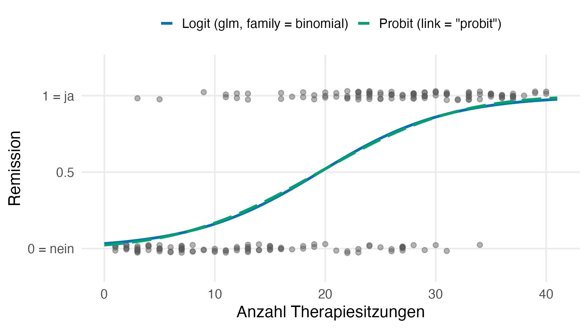{fig-alt="Streudiagramm der Remissionsdaten mit zwei an die Daten angepassten S-Kurven, Logit durchgezogen in Blau und Probit gestrichelt in Grün; die beiden Kurven liegen fast deckungsgleich übereinander." width="100%"}
:::
::: {.column width="40%"}
::: {.labels}
- Jede Umrechnung von 0 bis 1 auf $-\infty$ bis $\infty$ löst das Problem des Wertebereichs.
- **Probit:** Quantile der Standardnormalverteilung (`qnorm()`) statt Log-Odds
- in R: `binomial(link = "probit")`
- **Logit ist Standard:** $\beta_1$ lässt sich als Odds Ratio lesen.
:::
:::
::::

::: {.src}
Nicht bei Eid, Gollwitzer & Schmitt (2017); Vertiefung auf der Materialseite
:::

::: {.notes}
Der Logit ist eine Wahl, keine Notwendigkeit. Jede Funktion, die 0 bis 1 auf
den ganzen Zahlenstrahl abbildet, täte es. Die bekannteste Alternative ist das Probit:
statt der Log-Odds die Quantile der Standardnormalverteilung, qnorm aus Statistik I.
Hier sind beide an unsere Daten angepasst, und Sie sehen: praktisch dieselbe Kurve.
Logit ist Standard, weil β₁ sich als Odds Ratio lesen lässt, und Odds kennen Sie.
:::

## Perfekte Trennung: die Schätzung läuft weg {#bk-trennung .backup visibility="uncounted"}
<p class="track"><span class="kicker">Backup</span><span class="g on">Modell</span><span class="g">Interpretation</span><span class="g">Schätzung</span><a class="back" href="#/bk-index">↩ Index</a></p>

:::: {.columns .vcenter}
::: {.column width="60%"}
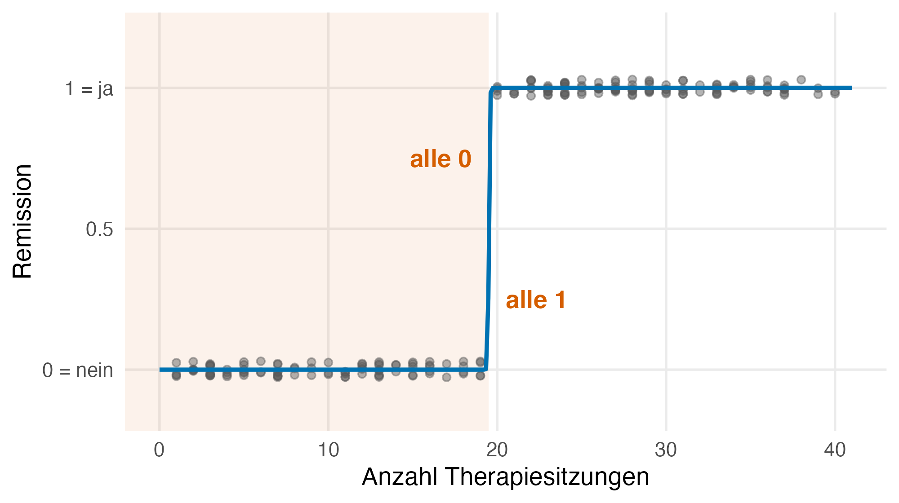{fig-alt="Konstruierte Daten: unter 20 Sitzungen liegen alle Punkte bei 0, ab 20 Sitzungen alle bei 1. Die angepasste Kurve springt bei 20 Sitzungen fast senkrecht von 0 auf 1." width="100%"}
:::
::: {.column width="40%"}
::: {.labels}
- Konstruiert: unter `r bval("sep_cut")` Sitzungen alle 0, ab `r bval("sep_cut")` alle 1
- $\pi_i$ wäre genau 0 oder 1: Odds 0 oder $\infty$, Log-Odds nicht definiert
- $L$ wächst mit $\beta_1$ immer weiter, kein Maximum

```{r sep-warn}
#| echo: false
#| comment: ""
cat(readLines("output/separation_warning.txt"), sep = "\n")
```

- **Voraussetzung:** Die Kategorie ist nie perfekt aus $x$ vorhersagbar.
:::
:::
::::

::: {.src}
Eid, Gollwitzer & Schmitt (2017), S. 804–805
:::

::: {.notes}
Zu gute Daten sind hier ein Problem. Wenn eine Schwelle die Nullen perfekt von
den Einsen trennt, erklärt jede noch steilere Kurve die Daten noch besser. Die Likelihood
hat kein Maximum, die Schätzung läuft ins Unendliche. R warnt genau davor: «fitted
probabilities numerically 0 or 1». Eid sagt es als Voraussetzung: Die Zugehörigkeit darf
nie perfekt vorhersagbar sein.
:::

## Gedankenexperiment: β₁ verdoppelt {#bk-doppelt .backup visibility="uncounted"}
<p class="track"><span class="kicker">Backup</span><span class="g">Modell</span><span class="g on">Interpretation</span><span class="g">Schätzung</span><a class="back" href="#/bk-index">↩ Index</a></p>

::: {.fig-mid}
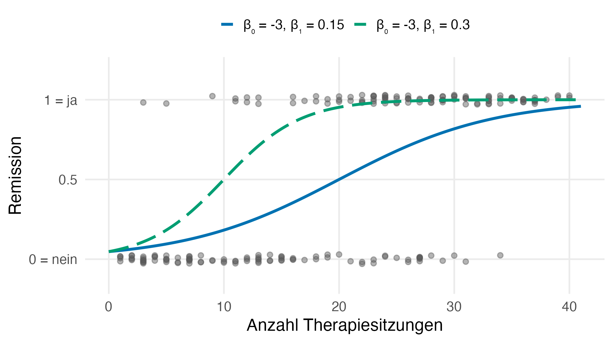{fig-alt="Zwei S-Kurven: durchgezogen mit Beta1 gleich 0.15, gestrichelt mit Beta1 gleich 0.30. Die gestrichelte Kurve ist steiler und erreicht 0.5 schon bei 10 statt bei 20 Sitzungen." width="64%"}
:::

::: {.lead .center}
$\pi = .5$ bei $x = -\beta_0/\beta_1$: mit $\beta_1 = `r beta1`$ nach **`r x_mid`** Sitzungen, mit $\beta_1 = `r 2 * beta1`$ schon nach **`r x_mid2`**.
:::

::: {.src}
Eid, Gollwitzer & Schmitt (2017), S. 801–802, Abb. 22.3
:::

::: {.notes}
Dieselbe Kurve mit doppelter Steigung: steiler, und der Punkt π = .5 wandert
von `r x_mid` auf `r x_mid2` Sitzungen, die halbe Strecke, weil er bei minus β₀ durch β₁
liegt. Die Steigung beschreibt den Zusammenhang in den Daten; ob die Sitzungen die
Remission bewirken, sagt sie nicht.
:::

## β₁ = `r beta1` heisst: Odds × `r f2(bval("or_1"))` pro Sitzung {#bk-or .backup visibility="uncounted"}
<p class="track"><span class="kicker">Backup</span><span class="g">Modell</span><span class="g on">Interpretation</span><span class="g">Schätzung</span><a class="back" href="#/bk-index">↩ Index</a></p>

::: {.fig-mid}
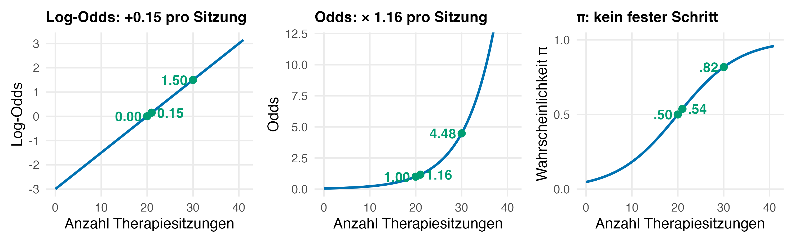{fig-alt="Drei Abbildungen desselben Modells über die Anzahl Sitzungen: links die Log-Odds als Gerade, in der Mitte die Odds als Exponentialkurve, rechts die Wahrscheinlichkeit als S-Kurve. Bei 20, 21 und 30 Sitzungen ist je ein Punkt beschriftet." width="96%"}
:::

::: {.skalen}
<div><b>Addition</b><span>pro Sitzung + `r beta1`</span></div>
<div class="hl"><b>Multiplikation: das Odds Ratio</b><span>pro Sitzung × `r f2(bval("or_1"))` $= e^{`r beta1`}$ · 10 Sitzungen × `r f2(bval("or_1"))`^10^ = `r f2(bval("or_10"))`</span></div>
<div><b>kein fester Schritt</b><span>20 → 21: +`r fmt_pi(bval("pi_or_2") - bval("pi_or_1"))` · 20 → 30: +`r fmt_pi(bval("pi_or_3") - bval("pi_or_1"))`</span></div>
:::

::: {.src}
Eid, Gollwitzer & Schmitt (2017), S. 804: $e^{\beta_1}$ ist das Odds-Ratio (Wettquotientenverhältnis)
:::

::: {.notes}
Dreimal dasselbe Modell. Links die Gerade, die Sie kennen: pro Sitzung plus
0.15 auf den Log-Odds. e hoch macht aus der Addition eine Multiplikation: Die Odds
wachsen pro Sitzung um den Faktor 1.16. Das ist das Odds Ratio. Nach zehn Sitzungen
1.16 hoch zehn, viereinhalbfache Odds. Rechts die Wahrscheinlichkeit: von 20 auf 21
Sitzungen plus .04, von 20 auf 30 plus .32. Kein fester Schritt.
:::

## Gleicher Schritt in π, ungleich viele Sitzungen {#bk-schritt .backup visibility="uncounted"}
<p class="track"><span class="kicker">Backup</span><span class="g">Modell</span><span class="g on">Interpretation</span><span class="g">Schätzung</span><a class="back" href="#/bk-index">↩ Index</a></p>

::: {.klicker}
**Handzeichen:** Welcher Schritt ist grösser, $.50 \to .60$ oder $.90 \to .95$?
:::

:::: {.columns .vcenter}
::: {.column width="58%"}
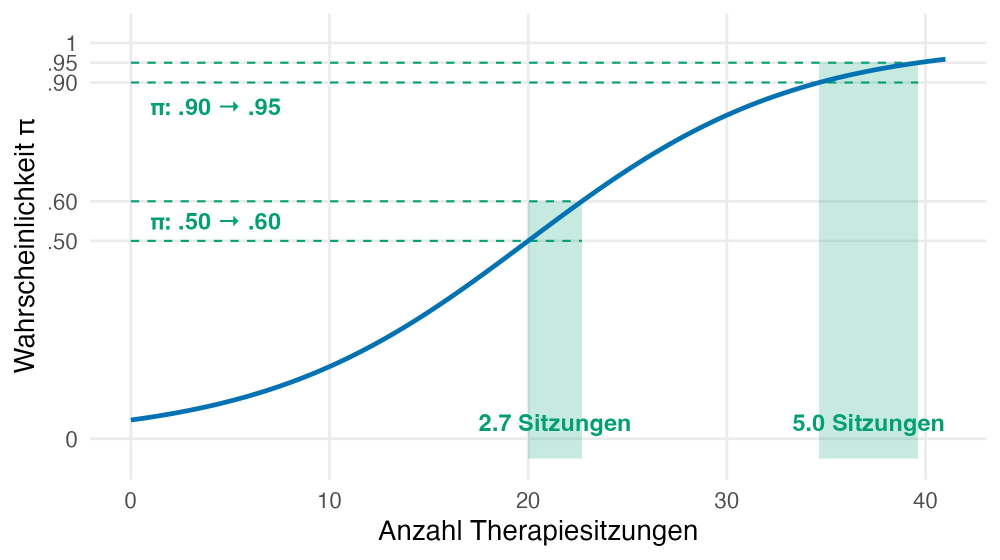{fig-alt="S-Kurve der Wahrscheinlichkeit über die Anzahl Sitzungen mit zwei grün markierten Fenstern: von .50 auf .60 braucht es 2.7 Sitzungen um den Wendepunkt, von .90 auf .95 braucht es 5.0 Sitzungen am oberen Rand." width="100%"}
:::
::: {.column width="42%"}
| $\pi$ | Odds | Log-Odds |
|---:|---:|---:|
| .50 | `r fnum(bval("odds_50"))` | `r f2(bval("lo_50"))` |
| .60 | `r fnum(bval("odds_60"))` | `r f2(bval("lo_60"))` |
| .90 | `r fnum(bval("odds_90"))` | `r f2(bval("lo_90"))` |
| .95 | `r fnum(bval("odds_95"))` | `r f2(bval("lo_95"))` |

::: {.labels}
- Log-Odds: **+`r f2(bval("d_lo_50_60"))`** gegen **+`r f2(bval("d_lo_90_95"))`**
- bei $\beta_1 = `r beta1`$: **`r f1(bval("dx_50_60"))`** gegen **`r f1(bval("dx_90_95"))`** Sitzungen
- konstant ist der Effekt auf den Log-Odds, nicht auf $\pi$
:::
:::
::::

::: {.src}
Eid, Gollwitzer & Schmitt (2017), S. 801: derselbe Unterschied in $x$ wirkt um den Wendepunkt viel stärker als in den Randbereichen
:::

::: {.notes}
Handzeichen, dann die Tabelle. Von .50 auf .60 gehen die Odds von 1 auf 1.5,
von .90 auf .95 von 9 auf 19. Auf der Log-Odds-Skala ist der zweite Schritt fast doppelt
so gross, plus 0.75 statt plus 0.41. Darum braucht die Kurve dafür fünf statt 2.7
Sitzungen. Der Effekt des Modells ist konstant, aber auf den Log-Odds; auf π sieht
derselbe Effekt am Rand klein aus.
:::

## Wie werden β₀ und β₁ geschätzt? {#bk-ml .backup visibility="uncounted"}
<p class="track"><span class="kicker">Backup</span><span class="g">Modell</span><span class="g">Interpretation</span><span class="g on">Schätzung</span><a class="back" href="#/bk-index">↩ Index</a></p>

::: {.lead}
Keine kleinsten Quadrate, sondern **Maximum Likelihood**: Wie wahrscheinlich sind die beobachteten 0 und 1, wenn das Modell mit $\beta_0, \beta_1$ gilt?
:::

$$L(\beta_0, \beta_1) = \prod_{i=1}^{n} \pi_i^{\,y_i}\,(1-\pi_i)^{\,1-y_i}, \qquad \pi_i = \frac{e^{\beta_0+\beta_1 x_i}}{1+e^{\beta_0+\beta_1 x_i}}$$

::: {.pipeline}
<div><b>Daten</b><span>`r n_total` Personen, je eine 0 oder 1</span></div>
<div><b>Likelihood</b><span>jede 1 trägt $\pi_i$ bei, jede 0 trägt $1-\pi_i$ bei; das Produkt hängt nur von $\beta_0, \beta_1$ ab</span></div>
<div class="hl"><b>Maximum</b><span>`glm(remission ~ sitzungen, family = binomial)` sucht die $\beta$, bei denen $L$ am grössten ist</span></div>
:::

| | wahr (Simulation) | `glm()`-Schätzung |
|---|---:|---:|
| $\beta_0$ | `r fnum(beta0)` | `r f2(gval("glm_intercept"))` |
| $\beta_1$ | `r beta1` | `r f3(gval("glm_slope"))` |

::: {.src}
Eid, Gollwitzer & Schmitt (2017), Abschn. 22.2, S. 810–811 (F 22.12)
:::

::: {.notes}
Es gibt keine Abstände zu einer Geraden, nur Nullen und Einsen mit ihren
Wahrscheinlichkeiten. Also fragen wir umgekehrt: Welche β machen unsere 200 Beobachtungen
am wahrscheinlichsten? Jede Remission trägt ihr πᵢ bei, jede Nicht-Remission 1 minus πᵢ,
das Produkt ist die Likelihood. glm sucht ihr Maximum numerisch. Hier liegt die
Schätzung nahe an den wahren Werten der Simulation.
:::

## Wo ist R²? Es gibt keine Varianz zu zerlegen {#bk-r2 .backup visibility="uncounted"}
<p class="track"><span class="kicker">Backup</span><span class="g">Modell</span><span class="g">Interpretation</span><span class="g on">Schätzung</span><a class="back" href="#/bk-index">↩ Index</a></p>

::: {.cards .compare}
<div class="lm">
<span class="verb">lineare Regression</span>
<strong>$R^2$: erklärter Anteil der Varianz</strong>
<p>$\sigma^2$: Streuung um $\mu_i$, für alle gleich</p>
<p>Varianz von $Y$ zerlegen: erklärt + Rest</p>
<p class="test">$R^2$ = erklärter Anteil</p>
</div>
<div>
<span class="verb">logistische Regression</span>
<strong>kein $\sigma^2$, nichts zu zerlegen</strong>
<p>$\text{Var}(Y_i) = \pi_i(1-\pi_i)$, durch $\pi_i$ festgelegt</p>
<p>Ersatz: Pseudo-$R^2$, die Likelihood gegen das Modell ohne $x$</p>
<p class="test">drei Vorschläge, drei Werte:</p>
</div>
:::

::: {.stats}
<div><b>`r fmt_pi(bval("r2_mcfadden"))`</b><span>McFadden</span></div>
<div><b>`r fmt_pi(bval("r2_coxsnell"))`</b><span>Cox & Snell</span></div>
<div><b>`r fmt_pi(bval("r2_nagelkerke"))`</b><span>Nagelkerke</span></div>
:::

::: {.lead .center}
Drei Zahlen für ein Modell, keine davon «erklärte Varianz». Üblich ist deshalb das **Odds Ratio** $e^{\beta_1}$ als Mass für die Stärke des Zusammenhangs.
:::

::: {.src}
Eid, Gollwitzer & Schmitt (2017), Abschn. 22.4, S. 816–818 (F 22.18–22.21): kein allgemein anerkanntes Mass, Werte meist kleiner als $R^2$
:::

::: {.notes}
R² lebt von der Varianzzerlegung: eine Streuung um die Gerade, die sich in
erklärt und unerklärt teilen lässt. Hier gibt es kein σ²; die Varianz jeder Person ist
π mal 1 minus π und steckt schon im Modell. Als Ersatz gibt es Pseudo-R²: Alle
vergleichen die Likelihood unseres Modells mit der des Modells ohne Sitzungen, aber
jedes skaliert anders, deshalb drei Werte. Eid empfiehlt, die Stärke über das Odds
Ratio zu beurteilen.
:::
